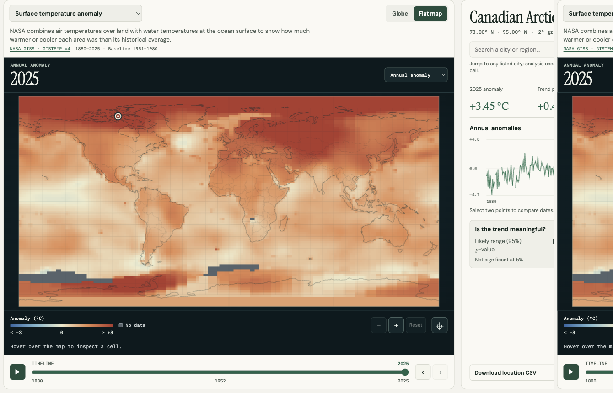

# GQ Atlas

A simple tool for exploring how Earth’s climate has changed over time.

Pick a variable (temperature, rainfall, ice, and more), choose a place, and see whether that place has warmed, cooled, gotten wetter, or dried — and whether the trend looks statistically meaningful.

Live site: [space.advay.ca](https://space.advay.ca)

## How to use

1. Type a city on the landing page, or open the world map.
2. Choose a climate layer.
3. Drag the timeline or type a year in its date field. Years after the latest data are violet: projections to 2100 with a 95% range, explained and tested on the [Projections](dist/projections/) page.
4. In the location analysis below the map, use **Compare** under place search to choose a second city or click a second cell on the map. The selected layer, period, and year apply to both places. Read A minus B and follow the two records on one chart. Use **Clear comparison** to return to one place.
5. Read the trend and significance for the primary cell. When both cells have 30 consecutive years in the same window, the comparison also shows their fitted rates.
6. Download the primary series (CSV), its fit statistics (JSON), or the chart and map (PNG).

Every layer's dataset page and original NetCDF file are linked under **Where this data comes from**.

## How to read it

- **Colors** show anomalies: warmer/cooler or wetter/drier than the usual baseline.
- **Anomaly** means difference from normal, not the absolute value.
- **Historical averages** shows the period baseline and the mean of all available historical anomalies for each selected cell. GISTEMP is supplied in anomalies relative to a zero reference.
- **Trend per decade** is the average rate of change over about 30 years.
- **Significant at 5%** means a flat (no-change) line is unlikely for that grid cell. It does not prove a cause.
- **Projected** values are a statistical estimate from past data with a stated error range, not a climate model forecast.
- Cities jump to the **nearest coarse grid cell** (~2°), not a weather station.

## NASA data

- [GISTEMP v4, Land–Ocean Temperature Index](https://data.giss.nasa.gov/gistemp/data_v4.html) (NASA GISS). This is the surface temperature anomaly layer, on a 2° grid, compared with 1951–1980. Original file: [gistemp1200_GHCNv4_ERSSTv5.nc.gz](https://data.giss.nasa.gov/pub/gistemp/gistemp1200_GHCNv4_ERSSTv5.nc.gz).

That is the only NASA dataset in the atlas. Precipitation, sea surface temperature, sea ice, and the reanalysis layers come from NOAA.

## Data

Main layers include NASA GISTEMP temperature, GPCP precipitation, NOAA ERSST sea surface temperature, NCEP/NCAR reanalysis fields, and OISST sea ice. Full citations and methods are on the [Data & methods](dist/data-and-methods/) page. Projection formulas and hindcast checks are on the [Projections](dist/projections/) page.
